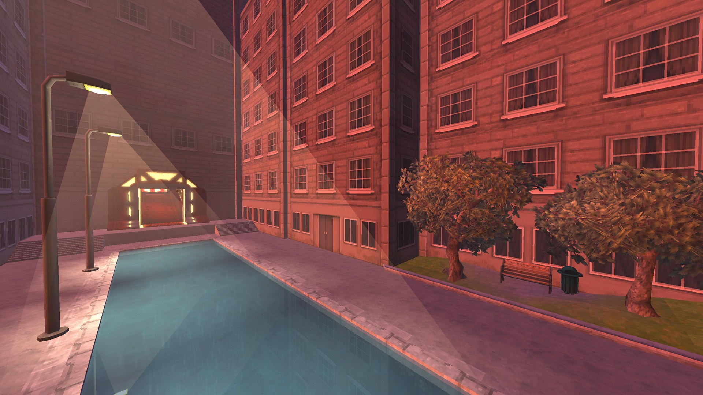
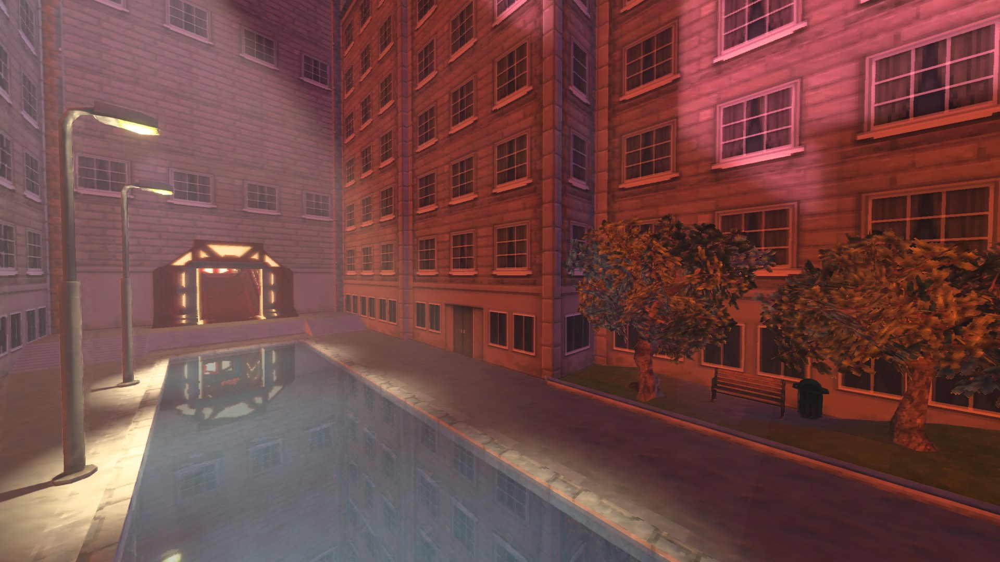
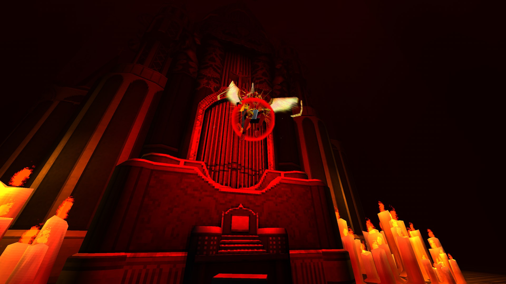
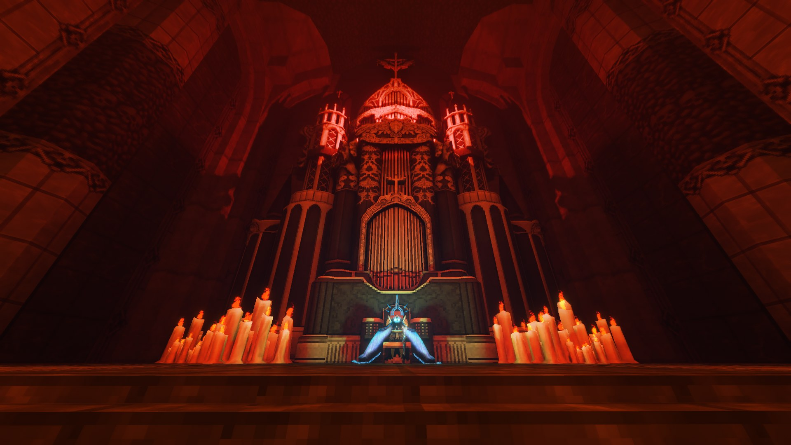

# UltraRT

UltraRT is a [BepInEx](https://github.com/BepInEx/BepInEx) mod that adds hardware ray tracing and path tracing to [ULTRAKILL](https://store.steampowered.com/app/1229490/ULTRAKILL/). It runs the game on DirectX 12 and traces shadows, bounce light, reflections, and volumetric fog in real time while keeping the pixel-art textures sharp. NVIDIA DLSS Ray Reconstruction is used for denoising if supported, or UltraRT's own denoiser if not. HDR10 output is supported on compatible displays.

> [!NOTE]
> **AI Generated Software Ahead**
>
> UltraRT was written almost entirely using agents, and would not (realistically) be possible without them.  
>
> The optional detail maps were generated by PBRify Remix, an image model trained on public domain textures. 

## Screenshots

| Vanilla | UltraRT (`pathtrace`) |
|---|---|
|  |  |
|  |  |

## Features

- **Path tracing and ray tracing:** soft shadows, multi-bounce global illumination, glowing surfaces and lava that cast real light, sky lighting, and auto exposure.
- **Reflections, glass, and water:** ray-traced reflections on metal, glass, water, and mirrors (showing V1 and your held weapon), stained-glass colored light, water caustics, and interactive ripples.
- **Dynamic combat and weather:** real-time light from gunshots, weapon beams, parries, explosions, fires, torches, and lightning.
- **Atmosphere and materials:** volumetric light shafts and fog, lit smoke and blood spray, bloom, heat haze, rain puddles, glossy wet blood on floors, and optional detail maps.
- **HDR10 output:** native HDR10 output for compatible displays (off by default).
- **In-game tools:** a settings menu in PluginConfigurator, a light editor, and a free camera with offline video rendering.

## View modes

Press **Page Up** or **Page Down** in game to switch modes, or change the default in **Options > Plugin Config > UltraRT**. On NVIDIA RTX GPUs with DLSS Ray Reconstruction installed, UltraRT starts in `pathtrace`. On other GPUs, it starts in `relight`.

| Mode | What it does |
|---|---|
| `pathtrace` | Full multi-bounce path tracing. Uses [DLSS Ray Reconstruction](docs/dlss.md) on NVIDIA RTX GPUs, or UltraRT's own denoiser otherwise. |
| `relight` | Faster ray tracing with soft shadows, one bounce of global illumination, reflections, and volumetric fog. |
| `pt-dn` | Ray tracing that keeps ULTRAKILL's original light falloff and flat ambient feel. |

## Performance

Measured on an RTX 5070 Ti at 2560x1440 on DirectX 12 with default settings (50% trace resolution; full breakdown in [docs/performance.md](docs/performance.md)):

| Scene | Stock (RT off) | `relight` | `pathtrace` |
|---|---|---|---|
| Typical levels | 280–460+ fps (2.2–3.6 ms) | 133–187 fps (5.3–7.5 ms) | 136–190 fps (5.3–7.4 ms) |
| Portal-heavy levels | 115–189 fps (5.3–8.7 ms) | 103–109 fps (9.2–9.7 ms) | 101–116 fps (8.6–9.9 ms) |
| Heavy combat | 170–255 fps (3.9–5.9 ms) | 81–102 fps (9.8–12.4 ms) | 87–108 fps (9.2–11.5 ms) |

For higher frame rates on slower GPUs, pick a faster **Quality preset** (`Ultra`, `High`, `Performance`, or `Competitive`) or lower **Trace resolution** in the settings menu.

## Requirements

- Windows and the Steam version of ULTRAKILL.
- A GPU with DirectX 12 ray tracing (DXR). UltraRT was built and tested on an RTX 5070 Ti; non-RTX cards use UltraRT's built-in denoiser.
- [BepInEx 5](https://github.com/BepInEx/BepInEx/releases), plus [PluginConfigurator](https://thunderstore.io/c/ultrakill/p/EternalsTeam/PluginConfigurator/) for the in-game settings menu.
- DirectX 12 launch options:

  ```
  -force-d3d12 -force-gfx-jobs legacy
  ```

  ULTRAKILL defaults to DirectX 11, where ray tracing is unavailable. `-force-gfx-jobs legacy` prevents a Unity DirectX 12 freeze when large levels unload.

## Install

Install **UltraRT** from Thunderstore with r2modman or Thunderstore Mod Manager, set the launch options above in your mod manager, and click **Start modded**. You can also install the optional **UltraRT_DetailMaps** package for subtle normal and roughness detail on the game's textures.

## Controls

| Key | Action |
|---|---|
| Page Up / Page Down | Switch view mode (`pathtrace`, `relight`, `pt-dn`) |
| F7 | Toggle ray tracing on or off |
| Insert | Open the in-game light editor (numpad to adjust, `Enter` to save) |
| Home | Toggle the free camera (`K` add key, `P` play, `Ctrl+S` save, `End` render offline) |

Individual effects also have session hotkeys (`F4` reflections, `F5` emissive lights, `Ctrl+F6` volumetrics, `Ctrl+F1` detail maps, and more). Hotkeys pause while the console (`F8`) or a text field is open, and they reset when you relaunch. Save permanent settings in **Options > Plugin Config > UltraRT**; see [docs/settings.md](docs/settings.md) for the full keybind, config, and command-line reference.

## Building from source

Needs Unity 2022.3.29f1 (for the shader bundle), a .NET SDK, and the Visual Studio C++ build tools.

```powershell
.\scripts\fetch-dlss.ps1               # optional: NVIDIA DLSS SDK parts (into gitignored lib\dlss)
.\scripts\fetch-pluginconfigurator.ps1 # optional: compile the PluginConfigurator settings menu
.\scripts\build.ps1 -NoDeploy          # build shaders, plugin, preloader, and native DLL into stage\
.\scripts\deploy.ps1 -Slot main        # deploy to the game install
.\scripts\bench.ps1                    # run the short benchmark suite
```

See [docs/release.md](docs/release.md) for Thunderstore packaging, [bench/README.md](bench/README.md) for benchmarking and multi-install locking, and [tools/materials/README.md](tools/materials/README.md) for generating detail maps.

## Documentation

| Doc | What it covers |
|---|---|
| [docs/settings.md](docs/settings.md) | Settings menu, config file, hotkeys, and command-line flags |
| [docs/release.md](docs/release.md) | Thunderstore packaging, install layout, detail-map pack, and licensing |
| [docs/relight.md](docs/relight.md) | `relight` mode: lighting model, tone curve, auto exposure, sky and sun |
| [docs/path-tracing.md](docs/path-tracing.md) | `pathtrace` mode: bounces, settings, cost, and noise |
| [docs/hdr.md](docs/hdr.md) | Experimental native HDR10 output and display curve |
| [docs/dlss.md](docs/dlss.md) | NVIDIA DLSS Ray Reconstruction setup and licensing |
| [docs/denoiser.md](docs/denoiser.md) | Built-in denoiser and temporal upsampler |
| [docs/light-sampling.md](docs/light-sampling.md) | RIS direct light sampling |
| [docs/radiance-cache.md](docs/radiance-cache.md) | World-space radiance cache for bounce light |
| [docs/emissive-lights.md](docs/emissive-lights.md) | Emissive surfaces, combat lights, and effect lights |
| [docs/lighting-overrides.md](docs/lighting-overrides.md) | Per-level light overrides, area and directional lights, and light editor |
| [docs/reflections.md](docs/reflections.md) | Ray-traced reflections, glass, water, and V1 in mirrors |
| [docs/materials.md](docs/materials.md) | Detail maps, stained glass, flesh glow, translucent shades, and curved normals |
| [docs/portals.md](docs/portals.md) | Portals, mirrors, and light passing through portals |
| [docs/scene-proxies.md](docs/scene-proxies.md) | Scene mirroring into the ray-tracing acceleration structure |
| [docs/volumetrics.md](docs/volumetrics.md) | Volumetric light shafts, fog, and lamp cones |
| [docs/particles.md](docs/particles.md) | Lit smoke, dust, debris, and blood spray |
| [docs/vfx.md](docs/vfx.md) | Bloom, heat haze, shockwaves, underwater grading, rain, and wet blood |
| [docs/lava.md](docs/lava.md) | Lava and acid as ray-traced light sources |
| [docs/caustics.md](docs/caustics.md) | Water caustics, refraction, absorption, and interactive ripples |
| [docs/viewmodel.md](docs/viewmodel.md) | Ray-traced lighting on the first-person gun and arms |
| [docs/aliasing.md](docs/aliasing.md) | Aliasing measurements across modes |
| [docs/cinematics.md](docs/cinematics.md) | Free camera, spline paths, offline renderer, and trailer assembly |
| [docs/performance.md](docs/performance.md) | 1440p frame-time breakdown and profiling |
| [docs/perf-audit-2026-11-21.md](docs/perf-audit-2026-11-21.md) | Performance audit and SOTA path-tracing optimization study |
| [docs/gpu-timer.md](docs/gpu-timer.md) | Native DirectX 12 per-pass GPU timer |
| [docs/ultrakill-rendering.md](docs/ultrakill-rendering.md) | Notes on ULTRAKILL's rendering pipeline |
| [bench/README.md](bench/README.md) | Benchmark runner, game lock, suites, and metrics |
| [tools/materials/README.md](tools/materials/README.md) | Offline detail-map generator |
| [AGENTS.md](AGENTS.md) | Notes for coding agents in this repository |
